# SkinPipe

[한국어 안내](README.ko.md) · [Browser guide](docs/browser.en.md) · [Installation and data](docs/catalog.en.md)

SkinPipe is a locally installed platform for compound screening in skin research. Start with a compound name or SMILES, a protein name, or a protein–ligand structure. Confirm the input, run a study, compare candidates, inspect structures and ADMET predictions, and download Excel workbooks.

This repository contains the software and installation instructions. Research inputs, study results, chemical databases, calculated predictions and model weights are kept in each user's installation folder. The platform starts with an empty study history and no predefined study targets.

## Preview: 3D structures and prediction profiles

**Mol\* 3D view — public PDB `1CBS`, chain A, observed ligand REA 200.** This is the original observed ligand in its receptor, viewed with **결합 부위** (*Binding site*); it is not a newly docked candidate. Drag to rotate and use the wheel/pinch to zoom in the app. [Open the 4K pocket image](docs/images/21-molstar-bound-pocket.png) or [the complete structure](docs/images/22-molstar-bound-overview.png).

[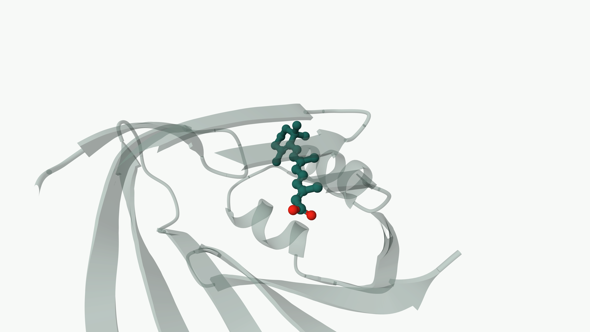](docs/images/21-molstar-bound-pocket.png)

**SwissADME-style radar presentation — SkinPipe's own axes and reference ranges.** The two graphs below show the public **Nicotinamide / PubChem CID 936** tutorial example, using cached **ADMET-AI 2.0.1** outputs. These are SkinPipe plots, not results from the SwissADME service. Green shows the compound; amber marks the four configured property reference ranges. Larger radii mean larger values, including larger toxicity-model outputs.

| Molecular properties | Toxicity model outputs |
|---|---|
| [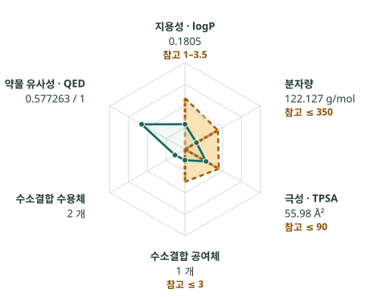](docs/images/23-nicotinamide-properties.svg) | [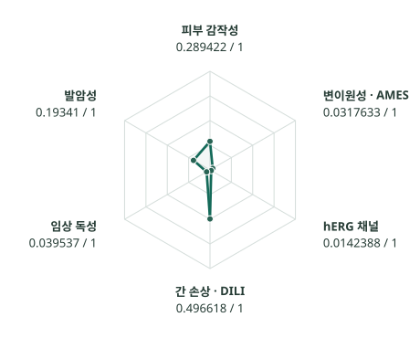](docs/images/24-nicotinamide-toxicity.svg) |

The 3D images are native **3840 × 2160 PNGs**; the plots are **SVG vectors**, which stay sharp when enlarged. Click an image for its original. In the app, use **원값·단위·표시 범위** (*Raw values, units and display ranges*) and **그래프 SVG 저장** (*Save graph SVG*). Follow the [illustrated study workflow](#your-first-study-in-pictures) below and the [3D walkthrough](docs/browser.en.md#bound-structure-example). [Image sources and capture details](docs/images/README.md).

## Install and start

Use a **regular user account on Ubuntu 24.04 x86_64**, with sudo access, Python 3 and an Internet connection. Allow **20 GiB of free space** for the starter installation. The installer requests the Ubuntu password in the terminal when installing system packages.

Paste this single command into the Ubuntu terminal:

```sh
python3 -c 'import urllib.request; exec(compile(urllib.request.urlopen("https://raw.githubusercontent.com/kangk1204/SkinPipe_public/main/install.py", timeout=30).read(), "SkinPipe installer", "exec"))'
```

It downloads the public source, installs the app and a separate ADMET model environment, obtains a small catalog from official providers, calculates ADMET, builds the search index and starts SkinPipe. Open **http://127.0.0.1:4317** in a browser after the terminal prints **`SkinPipe: http://127.0.0.1:4317`**. Keep that terminal open. The earlier **Installation prepared** message means setup has finished; the server may still be checking the database.

**The first preparation takes longer than later launches.** Models and dependencies are downloaded once; ADMET and the index are calculated before the research screen becomes ready. Follow the terminal messages and log paths. With `--device auto` (the default), a compatible NVIDIA GPU is tested and used when available; otherwise ADMET runs on CPU. Docking uses the installed CPU Vina engine. The installer does not install or change GPU drivers.

The default catalog is a small **starter** for learning the workflow. It does not provide the search breadth of the full library. Full-library preparation requires at least **300 GiB** of free space and can take **days on CPU**. Read [data sources, terms, progress and full preparation](docs/catalog.en.md) before choosing it. There is no bundled precomputed database to download from this repository.

For macOS or Windows, install on an Ubuntu server and use your browser through the [SSH tunnel instructions](docs/catalog.en.md#use-a-browser-on-macos-or-windows). Native macOS/Windows installation is not provided by this installer.

## Your first study, in pictures

The screenshots below come from an installed **0.3.0rc1 starter environment**. Try **Nicotinamide** first: it needs no protein or docking setup. The interface currently uses Korean labels; the instructions give the exact button text. Click any image to enlarge it. Counts and times will depend on your catalog and computer.

### 1. Check that the installation is ready

After the terminal prints **`SkinPipe: http://127.0.0.1:4317`**, open **http://127.0.0.1:4317** and click **설치 상태** (*Installation status*, top right). Look for **PostgreSQL 연결됨** and a catalog structure count. An unconnected optional ChatGPT account is normal. Click **연구 화면으로** (*Go to research*) to continue.

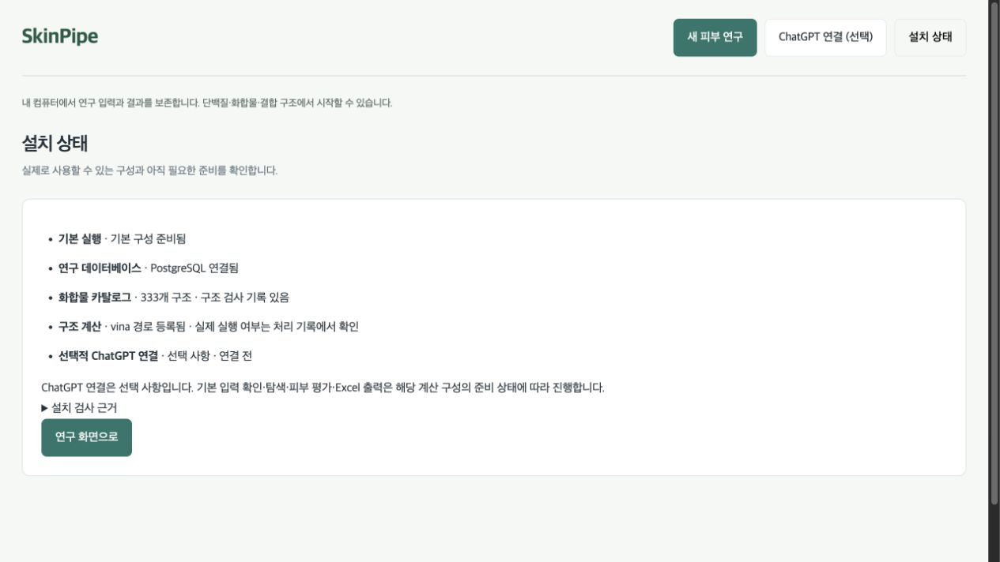

### 2. Enter a compound name

Choose **화합물을 알고 있어요** (*I have a compound*). Leave the input method as **화합물 이름** (*Compound name*), type `Nicotinamide`, then click **입력 확인하기 →** (*Check input*). Wait for the identity lookup; this has not started the study yet.

**If name lookup times out:** a study has not been submitted yet. Change **화합물을 알고 있어요 → input method → SMILES 분자 구조 (선택)**, enter this Nicotinamide example's exact structure `NC(=O)c1cccnc1`, and click **입력 확인하기 →** again. Check the 2D structure before continuing. A name-provider outage is distinct from an invalid molecule; use this path for another compound only when you have its verified SMILES.

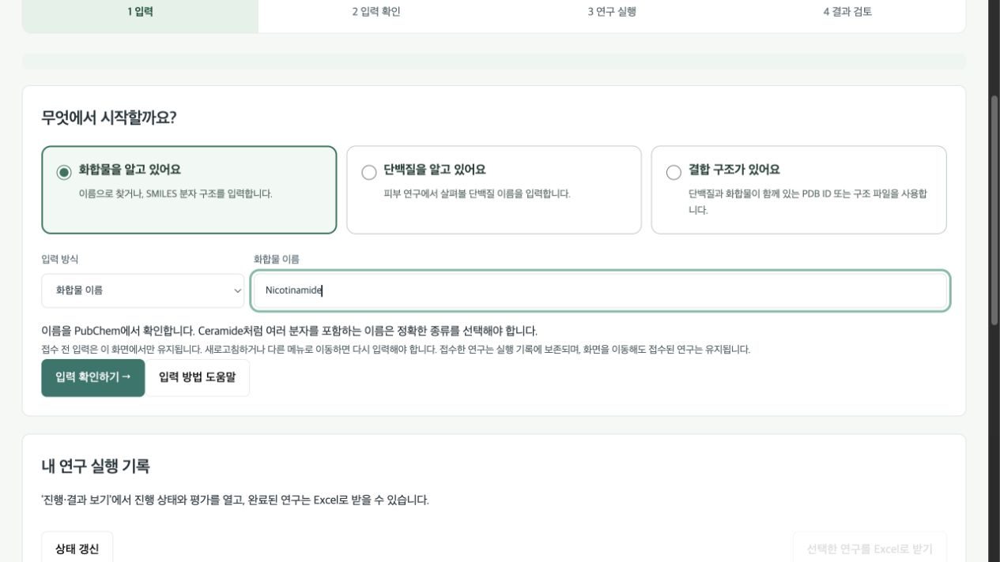

### 3. Check the molecule before proceeding

Check **Nicotinamide**, **PubChem CID 936** and the **2D structure**. If it is the wrong molecule, use **← 입력 수정** (*Edit input*). Otherwise click **이 입력으로 연구하기 →** (*Use this input*).

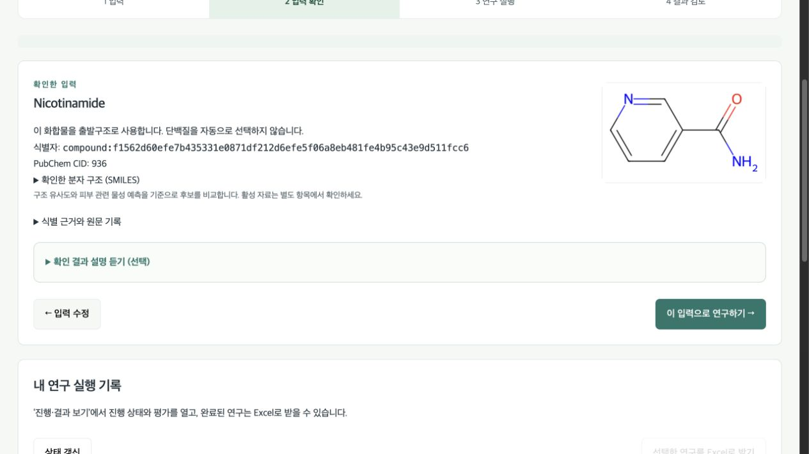

### 4. Choose a short first analysis and run it

Select **입력 화합물만 평가** (*Assess input only*) for this first example. Leave unknown skin/formulation/concentration fields empty. This evaluates one input molecule; it does not search for new candidates. Later, choose **비슷한 화합물 찾기** (*Find similar compounds*) or **다른 골격 후보 찾기** (*Find other scaffolds*) to screen the installed catalog.

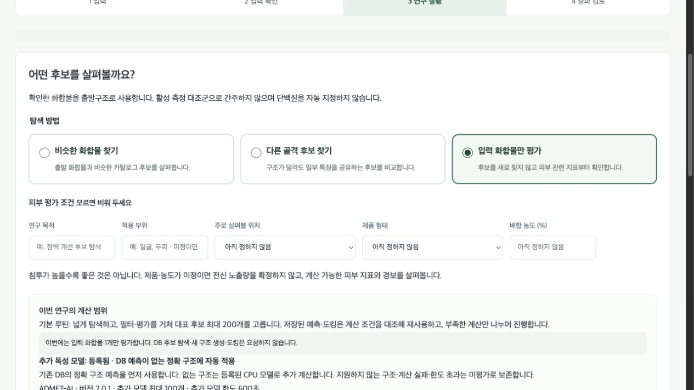

Scroll to the bottom, check the calculation scope, then click **새 연구 실행** (*Run new study*) **once**. The button changes to **연구 접수 중…** while the request is being accepted.

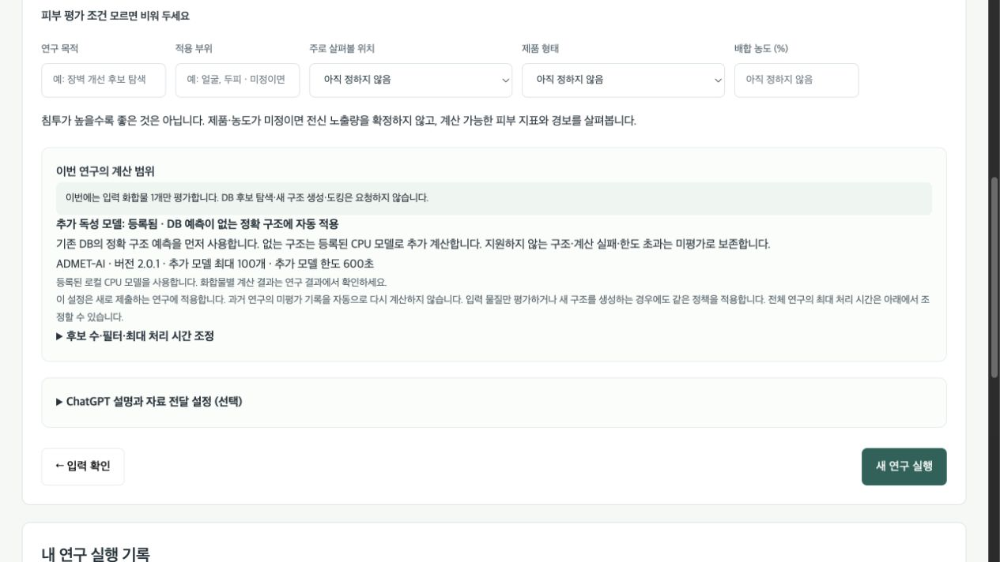

### 5. Follow the study and open its results

A moving indicator appears immediately after submission. A **blue panel and spinner** indicate waiting or processing; a **green panel, check mark and 연구 완료** (*Study complete*) indicate completion. Status refreshes every five seconds. A short assessment may finish almost immediately. Expect **1 input molecule** and **no new-candidate search** in this example. You can reopen the study using **진행·결과 보기** (*View progress/results*) in **내 연구 실행 기록** (*My study history*).

If a status request fails or no new response arrives for 20 seconds, the spinner stops and the panel says the current status is unknown. Click **결과 갱신** (*Refresh results*) to check again. Completion means processing has finished; inspect held and unassessed items in the results.

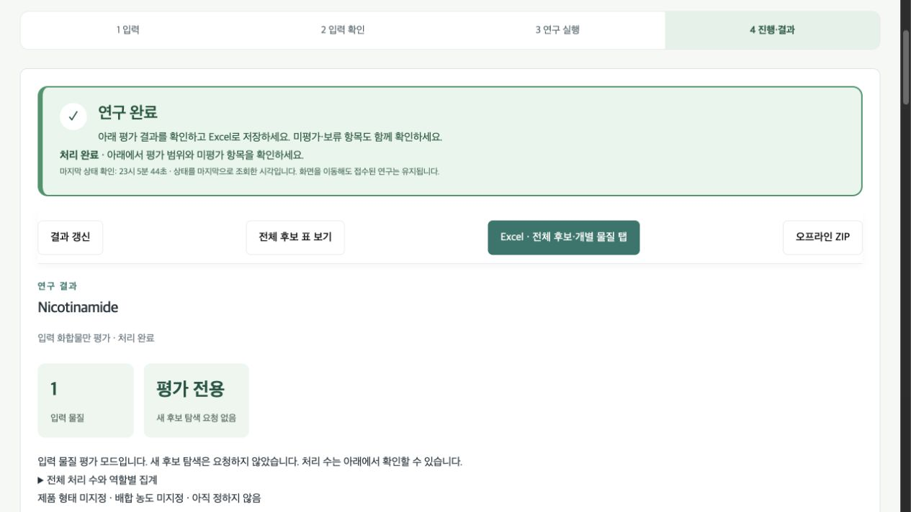

### 6. Inspect structures, skin properties and ADMET

Scroll down to the **2D structure**, skin properties and **기존 DB 독성·ADMET 예측** (*Cached toxicity/ADMET predictions*). The table shows each model output, scale and model version. Missing values remain unassessed. For a structure-based study, use the [3D pocket walkthrough](docs/browser.en.md#bound-structure-example) to inspect the observed ligand and receptor.

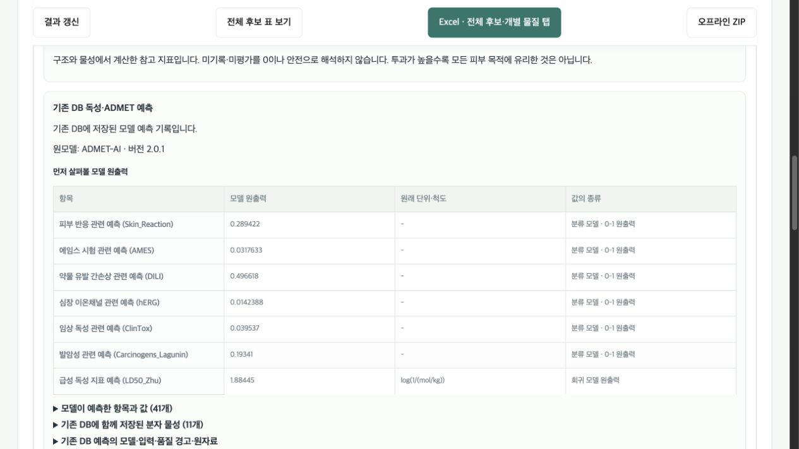

### 7. Save Excel — there are two clicks

First click **Excel · 전체 후보·개별 물질 탭** (*Excel: complete table and compound tabs*), or **Excel 받기** in the history. After preparation finishes, click the new **준비된 Excel 묶음 ZIP 저장** (*Save prepared Excel bundle ZIP*) link. The first click prepares the file; the second saves it to your browser's Downloads folder.

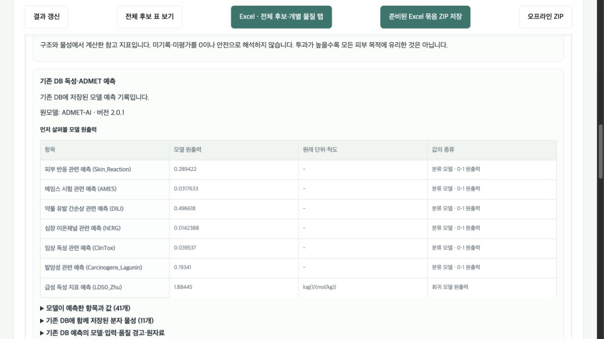

Extract the ZIP and open `review-0001.xlsx`. Start with **후보 검토** (*Candidate review*) and follow its links to individual compound tabs such as `C000001`. Keep the whole ZIP when sharing a study. A larger study may have several workbooks; its index links them together.

The candidate table automatically includes a **2D structure immediately before SMILES**. Each compound tab shows the same 2D structure and the original SMILES. A saved docking pose appears separately, with its own label. Missing or invalid SMILES remain visible with an explanation in place of the 2D image.

Readable columns show the evaluation score, docking, skin properties and structural alerts, six toxicity endpoints, solubility, molecular weight, logP, TPSA, hydrogen-bond counts and QED. Model identity, calculation status and purchase information follow. Predictions from multiple models remain labelled separately; missing and invalid values are explicit. The complete ADMET records remain in the raw-data columns and JSON files.

Hover over **?** beside a browser score heading to see its meaning, reading direction and comparison conditions. Keyboard focus also opens the help; click to keep it open and press Esc to close it.

The prediction section includes two six-axis radar charts: molecular properties and toxicity outputs. Each chart retains its model/source and shows raw values and units. Outer points mean larger values; property ranges are reviewed against your research goal. Missing or flagged values leave gaps. Open **원값·단위·표시 범위** for the original numbers and axis scales, or **그래프 SVG 저장** to save a graph. Display scales do not change scores or filters.

The translucent amber area with a bold dashed outline marks the highest component-score ranges in SkinPipe's skin-property policy: logP 1–3.5, molecular weight up to 350 g/mol, TPSA up to 90 Ų and HBD up to 3. HBA and QED have no reference band. The **?** beside the amber legend explains these ranges; the table lists them separately from the chart's display limits.

Excel column headings explain how to read each value: **↑ higher first**, **↓ lower first**, or **range/research-goal dependent**. The **지표 읽는 법** (*Reading the metrics*) sheet gives units, examples and comparison conditions. A more negative docking score is compared only within the same docking setup. Permeability, logP and molecular size are reviewed against the research goal. Compound tabs show the reading direction beside each metric.

You have completed the first workflow when the green panel says **연구 완료** and the downloaded workbook opens. Continue with the [illustrated browser guide](docs/browser.en.md) for **SMILES, protein and PDB/file inputs**, running/cancelling/resuming, candidate comparison, 2D/3D and multiple-study exports.

## Try the other inputs and analysis modes

Use **다른 입력으로 새 연구** (New study with another input) for each example and confirm its input. Earlier studies remain saved. A small first interaction check can set **후보 수·필터·최대 처리 시간 조정** to **representative target `2`, catalog limit `5`, time limit `0.1` hours**. These are practice limits, not a change to the normal 200/1,000/two-hour defaults or a validated research protocol. Assessment mode does not search candidates.

| Task | Continue from the README |
|---|---|
| SMILES assessment | **화합물을 알고 있어요 → SMILES 분자 구조 (선택)**, enter `NC(=O)c1cccnc1`, confirm the 2D diagram/SMILES, then **입력 화합물만 평가**. |
| Similarity or scaffold comparison | Confirm `Nicotinamide` or the same SMILES, then choose **비슷한 화합물 찾기** or **다른 골격 후보 찾기**. Submit each as a separate study. |
| Protein candidates | **단백질을 알고 있어요**, enter `HSP90AA1`, confirm human / P07900, then **이 단백질의 후보 찾기**. On the first screen, **다른 종·작용 방향을 지정하려면** offers **아직 정하지 않음 / 억제 후보 / 활성화 후보** (unspecified / inhibition / activation); confirm again after choosing. |
| Bound PDB structure | **결합 구조가 있어요 → PDB ID → `1CBS`**, check model 1 / chain A / REA / residue 200 / assembly, then **같은 단백질 포켓에서 다른 골격 후보 비교**. For upload, choose **PDB/mmCIF 파일** and an original file containing both protein and ligand. |
| Optional new structures | In compound similarity/scaffold or bound-structure mode, expand **새 분자 구조도 만들어 비교하기 (선택)** and enable generation. A small check can use BRICS recombination `2`, 3D comparison `2`, conformers `1`. Separate substitution products can make the total exceed two. Protein and assessment modes do not offer this choice. |

### First check of actual candidate docking

1. Choose **단백질을 알고 있어요**, enter `CRABP2`, confirm human / UniProt `P29373`, then **이 입력으로 연구하기 → 이 단백질의 후보 찾기**.
2. Open **후보 수·필터·최대 처리 시간 조정** and enter **PDB ID `1CBS`, protein chain `A`, reference ligand code `REA`**. Keep the displayed preparation-pH default. This path uses the observed coordinates and templates; pH-specific protein protonation is unassessed.
3. For a short workflow check set **representative target `3`, catalog limit `50`, time limit `0.5` hours**. Keep the purchase, structural-alert, toxicity and opposing-action filters unchanged. Click **새 연구 실행** once. Structure retrieval/retries can take several minutes before acceptance. If the reply is lost, use **내 연구 실행 기록 → 상태 갱신 → 진행·결과 보기** to find the accepted study before considering another submission.
4. When the blue progress panel turns green, read **후보 도킹과 관측 리간드 재도킹**: candidate calculations, new calculations, exact-condition reuse, and reference-redocking RMSD/QC are separate. Open **전체 후보 표 보기** for each candidate's pose QC and hold reasons.
5. Click **Excel · 전체 후보·개별 물질 탭 → 준비된 Excel 묶음 ZIP 저장**. Extract the ZIP and open `review-0001.xlsx`, its **후보 검토** table and `C000001`-style compound tabs. Retain the whole ZIP, including its source JSON and pose files.

For a bound-structure start, choose **결합 구조가 있어요 → PDB ID `1CBS`**, or select the [unmodified official mmCIF](https://files.rcsb.org/download/1CBS.cif) under **PDB/mmCIF 파일**. Confirm model 1 / chain A / REA / residue 200 / assembly 1, supplying the verified REA SMILES below if requested. Select **같은 단백질 포켓에서 다른 골격 후보 비교**, keep the same 3/50/0.5 limits and filters, then follow the same progress/results/Excel steps.

The operating-catalog check completed **3 new candidate docking calculations with passing pose QC** through the protein route and **2** through the mmCIF route. The latter exhausted the eligible pool before reaching the target of 3. Each study's one observed-ligand redocking is separate from these candidate counts. These yields are not guaranteed with the small starter catalog or another environment; follow [catalog preparation](docs/catalog.en.md) to increase coverage. Keep QC and filters unchanged. See [verification scope and zero/held outcomes](docs/candidate-docking-20261021.md).

**Larger study scope:** the 3/50/0.5 settings above are a short workflow check. Defaults remain **representative target 200, common-catalog limit 1,000, time limit 2 hours**; 200 is a target, not a guaranteed yield. Start a separate study and distinguish the requested limit, acquired candidates, docking plan, new calculations/reuse, pose QC and final representatives. See [catalog scope and the 3/2 candidate funnel](docs/catalog-scale-20261021.md) for the larger-run and Excel workflow.

**Time limit reached, with no Excel button:** saved calculations and checkpoints remain preserved, but an unpublished checkpoint is not a completed result or an Excel-ready snapshot. Click **입력·조건을 다시 확인해 별도 연구 준비** (*Prepare a separate study after rechecking inputs and conditions*), then reconfirm the same original input, structure selection, candidate source, filters and representative target while retaining QC criteria. The button does not restore the previous settings automatically. Explicitly give the new study a larger **maximum processing time**, for example 2 → 4 hours (maximum 8). This does not extend or resume the exhausted study. Stored calculations may be reused only when the server verifies matching calculation conditions; reuse and completion are not guaranteed. Follow the [budget-held study instructions](docs/catalog-scale-20261021.md#시간-한도로-보류되어-excel-버튼이-없을-때).

**Resource cleanup could not be verified:** the study is held, even if a docking/QC checkpoint reached its target. Inputs and saved calculation files remain preserved. Refresh the result; if the hold persists, open **내 연구 실행 기록 → 처리 기록** and ask the installation maintainer to inspect it. An unpublished checkpoint is not an Excel-ready result. The browser does not automatically restart the calculation or release the quarantine.

If the `1CBS` upload requests exact ligand SMILES, RCSB's [REA record](https://files.rcsb.org/ligands/download/REA.cif) provides `SMILES_CANONICAL` (OpenEye OEToolkits 1.7.6). **For this 1CBS/REA example only**, first check chain A / REA / residue 200 and the protein chain, enter the value below, then **선택한 결합 화합물 확인**. Do not reuse it for a different ligand.

```text
CC1=C(C(CCC1)(C)C)/C=C/C(=C/C=C/C(=C/C(=O)O)/C)/C
```

Check conditions and data permissions, then click **새 연구 실행** once. Follow steps 5–7 above through **progress/results → status and unassessed items → prepare Excel → save ZIP → open workbook**. Green completion does not mean every endpoint succeeded; read zero candidates and held docking with their reasons. A requested protein action does not establish inhibition or activation. Do not use `1CBS` as an HSP90AA1 docking structure. See the [mode-by-mode instructions and zero/held-result guidance](docs/browser.en.md#mode-by-mode-walkthrough).

## Start, stop and check progress

After installation:

```sh
bash ~/SkinPipe/runtime/Start-SkinPipe.sh
```

In a second terminal, to stop your local app and its managed jobs:

```sh
bash ~/SkinPipe/runtime/Stop-SkinPipe.sh
```

After dependency and model installation creates `Catalog-Status.sh`, inspect first-time catalog preparation:

```sh
bash ~/SkinPipe/runtime/Catalog-Status.sh
```

If catalog preparation was interrupted after all launchers, including `Prepare-Catalog.sh`, were created, rerun the original installation command with the same options. It resumes the saved catalog rather than starting a second build. Dependency installation failures before that point retain their logs; the error explains how to retry with a new installation folder. Starting an already prepared installation does not recalculate its full ADMET cache.

In the browser, use **설치 상태** — *Installation status* to check the database, search index, model and docking engine. See [troubleshooting and file locations](docs/catalog.en.md).

## ChatGPT is optional

Core screening, local prediction, result viewing and Excel export work without ChatGPT. **ChatGPT 연결 (선택)** opens the account connection flow; **문헌 검토** reviews public literature. Input guidance and result explanations use the data categories you permit for that study.

The model selector prefers `gpt-6-luna` with `max` reasoning when the account advertises that choice. If Luna is absent, it uses an explicitly advertised provider default; if no default is returned, select an available model yourself. A failed request does not silently switch models or turn into a separately billed API request. Actual model access and usage limits depend on the connected account. See [ChatGPT setup and data controls](docs/browser.en.md#optional-chatgpt).

## Development

The [2026-10-20 verification record](docs/validation-20261020.md) covers the
previously omitted tests, fresh Ubuntu installation, browser workflow and
progress indicators, including an unchanged run of the published one-line
installer through Excel download and result reopening after app restart,
with the execution scope and scientific limits.

```sh
python3 scripts/check-public-tree.py
python3 -m unittest discover -s tests -v
node tests/test_research_progress.mjs
python3 -m pip wheel --no-deps --wheel-dir /tmp/skinpipe-public-wheel ./skinpipe
```

Put installations and test outputs outside the checkout. Before contributing, read [CONTRIBUTING.md](CONTRIBUTING.md). Distribution licensing for SkinPipe is being decided; no project license has been selected. Bundled third-party components retain their own notices.

[Operating browser mode verification (2026-10-21)](docs/validation-modes-20261021.md) records the protein, PDB/file and compound workflows, actual Excel downloads and retained scientific holds.
