# 브라우저 사용 순서

[English](browser.en.md) · [README](../README.ko.md)

설치 터미널에 **Ready**가 나오면 http://127.0.0.1:4317 을 엽니다. 입력 → 확인 → 실행 → 결과의 네 단계입니다.

아래는 로컬 **0.3.0rc1 starter 설치본**에서 촬영한 공개 예제입니다. 화합물은 Nicotinamide, 단백질은 HSP90AA1, 결합 구조는 PDB 1CBS를 사용했습니다. 이미지를 누르면 확대됩니다. 화면 안내용 예제이며 연구 DB를 함께 배포하는 것은 아닙니다.

## 1. 무엇에서 시작할까요?

**새 피부 연구**에서 입력 종류를 먼저 선택합니다.

| 시작점 | 넣을 자료 | 확인할 사항 |
|---|---|---|
| **화합물을 알고 있어요** | 화합물 이름. SMILES가 있으면 입력 방식을 **SMILES 분자 구조**로 변경 | 정확한 2D 구조·입체화학·염·전하 |
| **단백질을 알고 있어요** | 단백질 이름·유전자명·식별자 | 공식 단백질과 생물종. 기본은 화면에 표시된 사람 |
| **결합 구조가 있어요** | PDB ID 또는 **PDB/mmCIF 파일** 업로드 | 모델·단백질 사슬·리간드 위치·포켓 |

**입력 확인하기 →**를 누르면 확인 중 표시가 나옵니다. 단백질을 선택하면 입력 방식도 단백질용으로 바뀝니다. 여러 분자·가족·혼합물을 뜻하는 이름은 정확한 대상이나 구조를 선택해야 합니다. 화합물을 관련 단백질로 자동 치환하지 않습니다. 조회가 실패하면 입력 화면에서 필요한 다음 행동을 안내합니다.

### SMILES 예제

화합물 입력 방식에서 **SMILES 분자 구조 (선택)**을 고르고 `NC(=O)c1cccnc1`을 붙여넣습니다. Nicotinamide의 구조이며 이름 입력과 같은 확인 순서로 이어집니다.

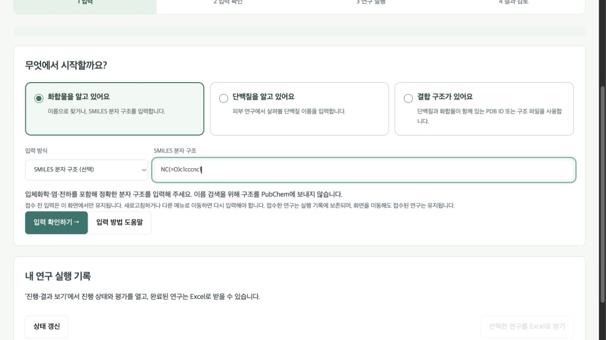

### 단백질 예제

**단백질을 알고 있어요**를 선택하고 `HSP90AA1` → **입력 확인하기 →**를 누릅니다. 화합물 이름 메뉴 대신 단백질 입력창이 나옵니다. 다음 화면에서 **Homo sapiens / UniProt P07900**을 확인합니다.

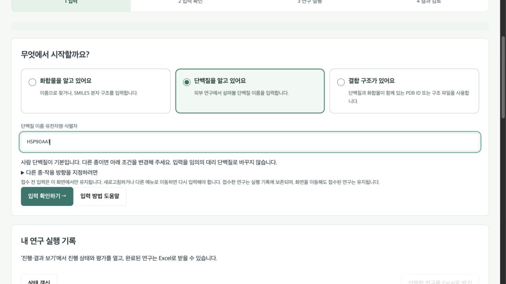

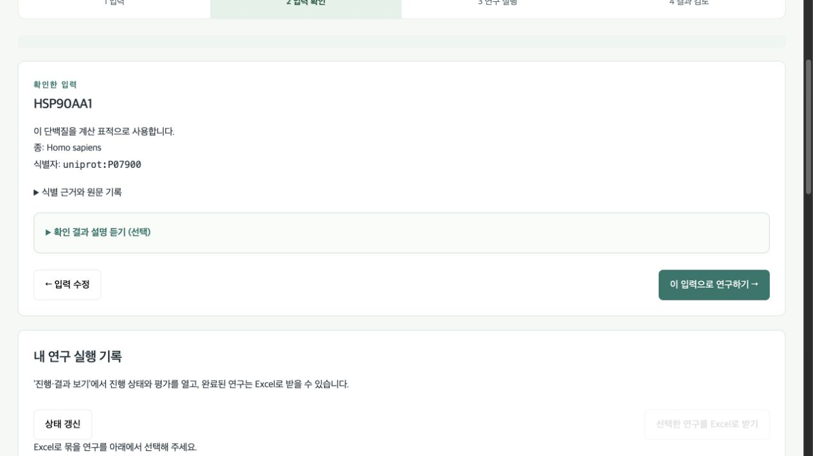

### 결합 구조 예제

**결합 구조가 있어요** → **PDB ID**를 선택하고 `1CBS`를 입력합니다. 파일을 쓰려면 같은 메뉴에서 **PDB/mmCIF 파일**을 선택하고 파일 선택 버튼을 누른 뒤 **입력 확인하기 →**로 진행합니다.

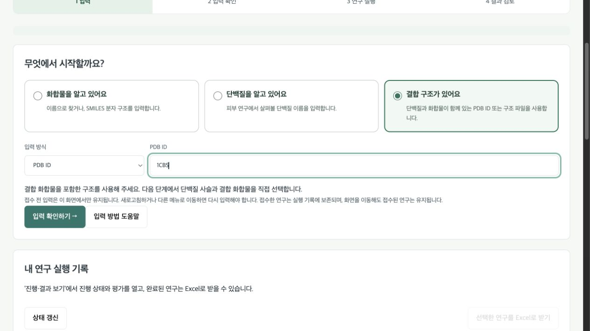

## 2. 입력 확인

**확인한 입력**에서 이름·식별자·조회 출처를 읽습니다. 화합물은 2D 그림과 SMILES, 단백질은 생물종을 확인합니다. 결합 구조는 모델·사슬·리간드를 확인하고 필요하면 **구성이나 정확한 분자 구조를 다시 선택**합니다. 화학 정보가 부족하면 요청하는 SMILES·SDF를 보완합니다.

결합 구조의 포켓은 실제 관측된 리간드 좌표에서 정합니다. 자유 배좌·관측 자세·도킹 자세는 구분합니다. 단백질의 생물학적 이름을 연결하지 못해도 검증한 구조 자체를 계산에 사용할 수 있습니다.

잘못 넣었으면 **← 입력 수정**, 맞으면 **이 입력으로 연구하기 →**를 누릅니다. 여기까지는 연구 계산을 시작하지 않습니다.

공개 `1CBS` 예제에서는 **모델 1 / 사슬 A / REA / 잔기 200**, 조립체를 확인합니다. **결합 화합물과 주변 포켓을 3D로 확인**을 누르면 관측 포켓이 열립니다. 리간드가 여러 개라면 **구성이나 정확한 분자 구조를 다시 선택**에서 선택합니다.

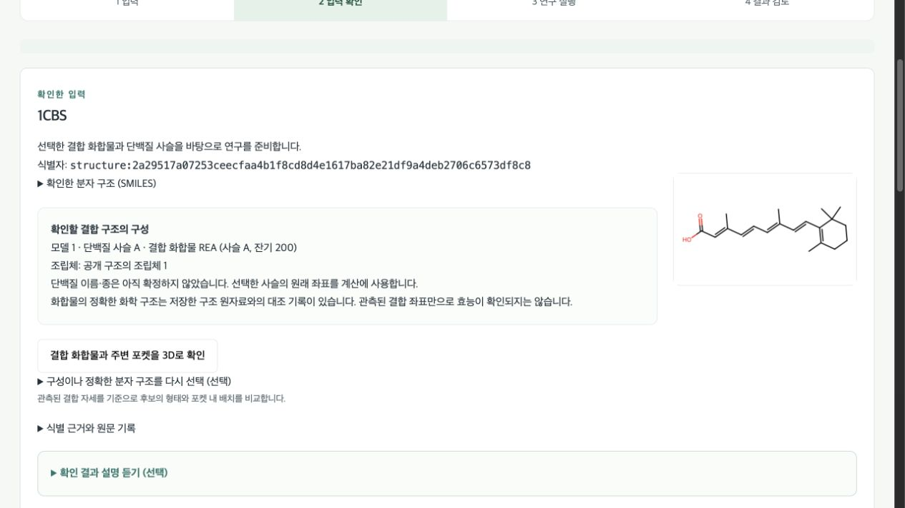

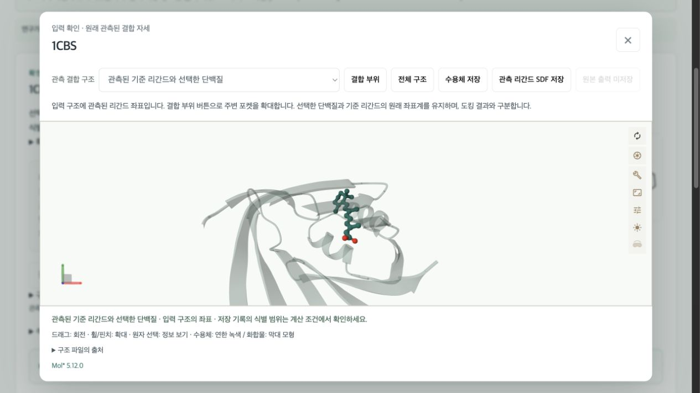

**3D 조작:** 드래그로 회전, 휠·핀치로 확대, **결합 부위**로 포켓 확대, **전체 구조**로 전체 보기, **×**로 닫습니다. 위 화면은 공개 PDB의 관측 리간드이며 새 도킹 결과 화면과 구분됩니다.

## 3. 탐색 방식과 조건

화합물은 **유사 후보 탐색 / 다른 골격 탐색 / 입력 물질만 평가** 중 선택합니다. 단백질 없이 화합물만 평가하거나 호핑할 수 있습니다. 단백질 모드는 표적 근거와 후보를 찾고, 구조·포켓을 정하면 도킹합니다. 결합 구조 모드는 선택한 리간드로 호핑하고 같은 수용체·좌표·포켓에서 도킹합니다. 재도킹 실패나 미지원 조건은 해당 단계를 보류하고 결과에 표시합니다.

**피부 평가 조건**에서 목적을 정하고, 알면 제형·농도·적용 부위를 입력합니다. 모르면 비우거나 **아직 정하지 않음**을 선택합니다. 조건이 없으면 임의의 로션·농도로 노출을 계산하지 않습니다. 모든 입력 모드에서 발견한 화합물의 피부 지표와 확보한 독성 예측을 살펴봅니다.

기본 루틴은 **대표 후보 최대 200개**, **DB 평가 최대 1,000개**, **연구 최대 2시간**입니다. 보장하는 후보 수가 아니라 계산 한도입니다. 필터·중복·출처·도킹/QC에 따라 후보가 줄 수 있습니다. **후보 수·필터·최대 처리 시간 조정**에서 바꿀 수 있습니다. **새 분자 구조도 만들어 비교하기**는 선택 기능이며 기본은 꺼짐입니다.

추가 독성 패널에서 로컬 모델 등록 상태를 확인합니다. 정확한 구조의 DB 예측을 먼저 쓰고, 없는 구조는 등록된 모델로 계산합니다. 미지원·실패·예산 초과는 미평가로 남습니다.

**ChatGPT 설명과 자료 전달 설정 (선택)**에서 보낼 자료를 확인한 뒤 **새 연구 실행**을 한 번 누릅니다. 접수 중 표시가 나옵니다. 접수가 오래 걸리거나 시간 초과가 나면 먼저 실행 기록을 확인하세요.

## 4. 진행·취소·재개

접수한 연구는 **내 연구 실행 기록**에 저장됩니다. 단계·경과 시간·완료 수·보류/실패를 확인합니다. 오래 열어 둔 화면은 **상태 갱신**, 다른 연구를 열려면 **진행·결과 보기**를 누릅니다. 해당 결과 패널로 화면이 이동합니다.

접수 후 메뉴 이동·브라우저 종료는 분석 취소가 아닙니다. 접수 전 입력은 화면 이동·입력 종류 변경 시 사라질 수 있으므로 다시 확인합니다. 입력 수정은 화면의 뒤로가기 버튼을 사용하세요. 브라우저 뒤로가기는 페이지를 바꾸며 저장한 연구를 지우지 않습니다.

계산을 중단하려면 해당 연구의 취소 기능을 사용하고 취소·자원 정리 완료 표시까지 확인합니다. 취소 요청 접수와 자원 반환 완료는 다릅니다. 완료한 관측과 로그는 남기고, 해당 작업이 관리하는 자식 프로세스를 정리합니다. 다른 연구는 종료하지 않습니다. 정리가 되지 않으면 오류로 표시합니다.

재개 가능한 중단·취소 연구에는 재개 기능이 나옵니다. 저장한 입력·DB·모델·조건을 대조한 뒤 끝낸 계산을 이어 사용합니다. 조건이 달라지면 새 연구가 필요할 수 있습니다. 화면이 바뀌었다는 이유만으로 새 분석을 중복 제출하지 마세요. 로컬 앱 전체를 종료할 때는 설치 폴더의 **Stop-SkinPipe.sh**를 사용합니다.

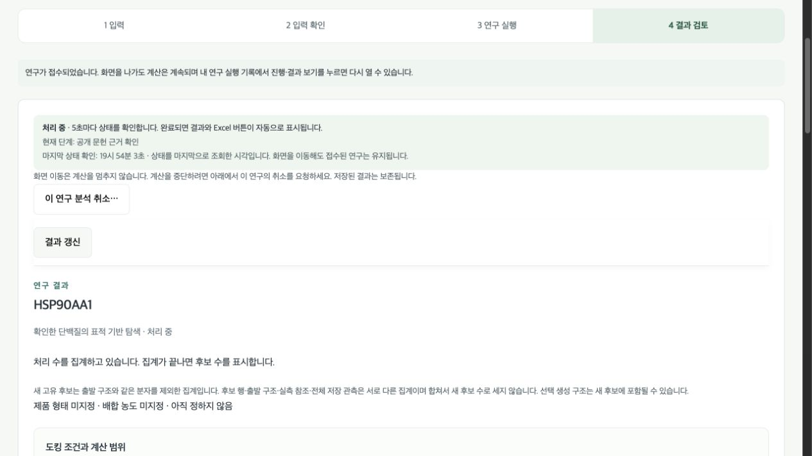

위 진행 화면은 시간이 더 걸리는 별도 예제입니다. 간단한 Nicotinamide 평가는 중간 단계가 보이기 전에 끝날 수 있습니다.

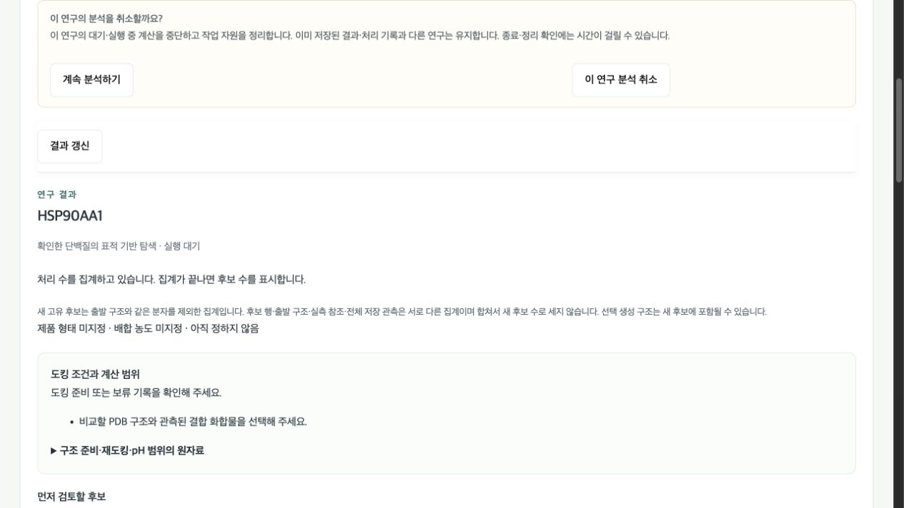

**계속 분석하기**는 현재 계산을 유지하고, **이 연구 분석 취소**는 취소를 확정합니다. 위 그림은 확인창 단계입니다. 취소를 확정했다면 이후 자원 정리 상태까지 확인하세요.

## 5. 결과와 구조 보기

요약은 새 고유 후보·대표 후보·생성 구조·출발구조/참조/대조·제외/보류·저장 관측을 구분합니다. 참조 행은 새 후보 수에 더하지 않습니다. 작업이 완료되어도 도킹이나 일부 지표는 보류·미평가일 수 있으므로 단계별 내용을 확인합니다.

개별 후보는 **이름/ID·SMILES·2D 구조 → 탐색/호핑 근거 → 도킹·3D 자세 → 피부·독성/ADMET → 구매·합성 정보 → 출처** 순서로 봅니다. ADMET은 모델·출처·상태와 함께 읽습니다. 결측은 0이나 안전으로 바꾸지 않습니다.

2D는 결합 구조를, 3D는 공간 좌표를 보여줍니다. 3D를 회전·확대할 수 있습니다. 저장 자세가 없으면 없다고 표시하며 자유 배좌를 결합 자세로 표시하지 않습니다. 작은 화면에서는 보던 뷰어를 닫은 뒤 다른 후보를 엽니다.

완료한 연구에서 **전체 후보 표 보기**를 누르면 후보를 비교할 수 있습니다. 필터는 여러 개를 켜고 끌 수 있고 **선택한 조건을 모두 만족(AND)**해야 표시됩니다. **제외 필터 해제**로 제외 조건을 지웁니다. 분석 스냅샷·검색어·정렬은 별도입니다. 저장 수·조건 통과 수·표시 상한을 구분합니다. 정렬은 표시 순서만 바꿉니다. 활성·독성 미평가를 숨길지 포함할지도 확인합니다.

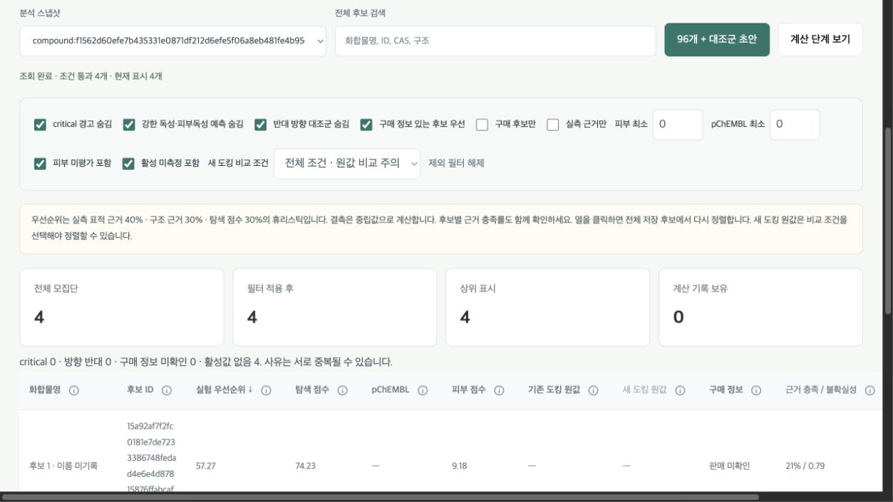

위 유사 후보 탐색 예제는 출발구조와 중복 구조를 포함한 **저장 관측 4개**이며, 연구 요약의 **새 고유 후보는 2개**입니다. 첫 번째 ‘입력 화합물만 평가’ 예제는 새 후보를 찾지 않습니다.

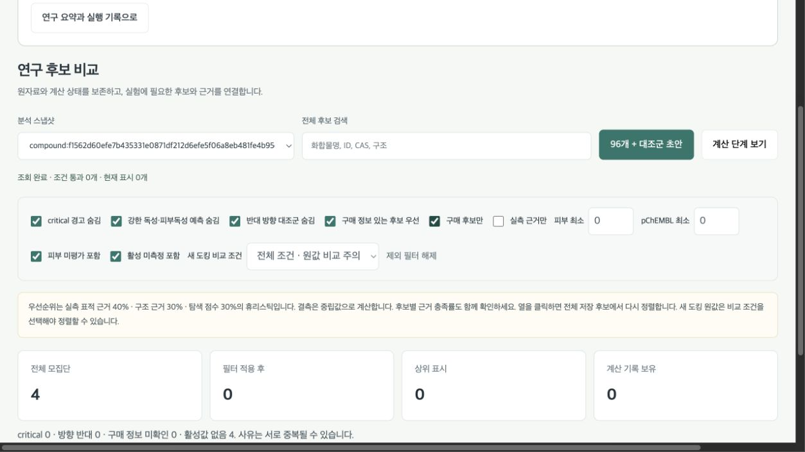

표가 비면 **전체 모집단**과 **필터 적용 후**를 비교하세요. 위 예제는 구매 후보만 조건으로 4개가 모두 숨겨졌습니다. 해당 체크를 끄거나 **제외 필터 해제**를 누르면 다시 볼 수 있습니다. 필터는 저장 결과를 삭제하지 않습니다.

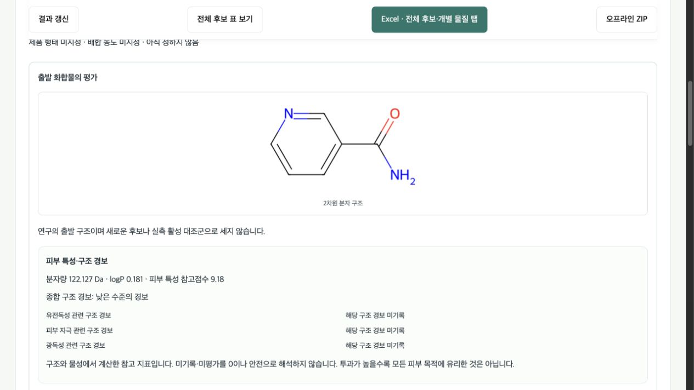

## 6. Excel과 원자료 받기

연구의 **Excel 받기**를 누르고 준비가 끝난 다운로드를 선택합니다. 여러 연구는 **Excel에 포함**을 체크하고 **선택한 연구를 Excel로 받기**를 누릅니다.

**Excel 묶음 ZIP**을 내려받으면 압축을 풀고 요약·전체 후보·개별 화합물 탭·조건·근거를 확인합니다. 화합물 탭은 최대 200개씩 나뉘므로 전체 묶음을 보관하고 인덱스에서 찾습니다. 같은 화합물이 여러 연구에 있어도 각각의 관측·조건을 유지합니다. 제외·실패·미평가와 후보 0개 연구도 보존합니다. 화면 표시 상한으로 내보내기를 잘라내지 않습니다.

요약 시트에서 연구를, 후보 인덱스에서 화합물 탭을 찾습니다. 개별 탭에는 구조 그림·핵심 수치·선정/제외 이유·피부/독성·문헌을 담습니다. 공동연구자에게는 JSON·SDF·실행 조건도 함께 보관해 전달하세요. 내보내기가 실패해도 연구는 남아 있으므로 표시된 문제를 해결하고 내보내기만 다시 요청할 수 있습니다.

**다운로드 확인:** 브라우저 다운로드 폴더에 `SkinPipe-…-xlsx.zip`이 있는지 확인합니다. 압축 해제 → `review-0001.xlsx` 열기 → **후보 검토** → `C000001` 순서로 봅니다. 첫 평가 예제는 입력 물질 1행·개별 탭 1개입니다. 새 후보 탐색은 다른 모드에서 진행합니다.

## 선택적 ChatGPT 사용

**ChatGPT 연결 (선택)** → **Continue with ChatGPT**를 누르고 계정 제공자 화면에서 직접 로그인한 뒤 돌아옵니다. 연구 입력창에 비밀번호·세션 파일·API 키를 넣지 마세요. **연결 상태 갱신**으로 확인하고 **ChatGPT 연결 해제**로 끊습니다. 자격 정보는 보호된 로컬 설치에 보관하며 Excel에 넣지 않습니다.

- **입력 안내:** 검증한 식별 결과와 선택지를 쉽게 풀이합니다. 구조를 대신 확정하지 않습니다.
- **문헌 검토:** 주제·생물종·작용 방향을 넣고 수집한 논문을 확인한 뒤 모델을 실행합니다. 주장에는 출처와 근거 문장이 연결됩니다.
- **결과 설명:** 전달을 허용한 저장 결과에서 수치·선정 이유·미평가를 요약합니다.

계정의 모델 목록에서 고릅니다. `gpt-6-luna` · `max`가 있으면 먼저 선택하고, Luna가 없으면 제공자가 반환한 기본 모델을 선택합니다. 둘 다 없으면 직접 고릅니다. 추론 강도는 해당 모델이 지원하는 값을 확인합니다. 목록에 보이는 것과 실제 호출 성공은 다르며, 호출이 완료돼야 사용 가능 여부를 확인할 수 있습니다. 시간 초과·사용량 제한·응답 검증 실패는 AI 단계에 표시하며 기본 계산·Excel은 사용할 수 있습니다. 별도 유료 API로 자동 전환하지 않습니다.

공개 문헌 검토와 비공개 SMILES·업로드 구조·계산 결과 전달 동의는 별도입니다. 실행 전에 전달 범위를 확인하세요. ChatGPT는 확정 입력·포켓·독성 수치·점수·작업 상태를 바꾸지 않습니다. 연결하지 않아도 저장한 수치와 기본 형식의 결과 설명을 볼 수 있습니다.

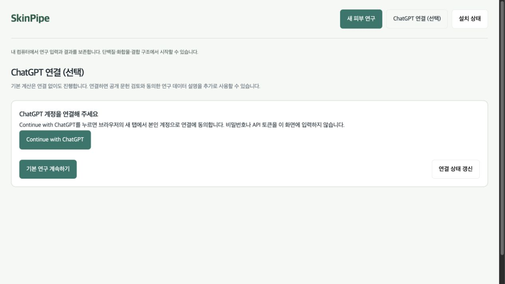
